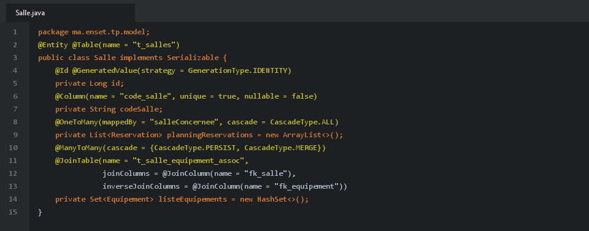
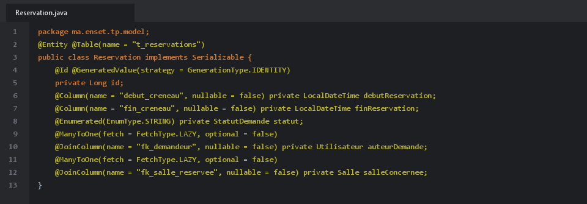
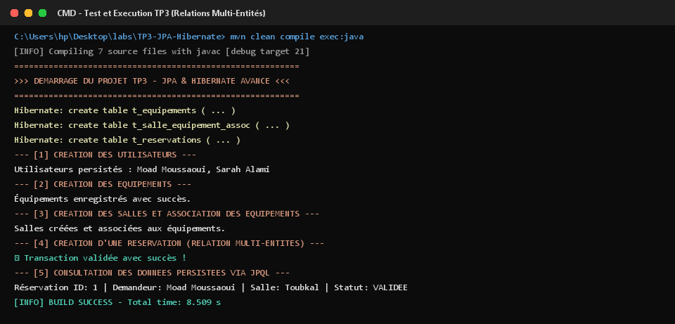

# TP 3 : Gestion Avancée des Entités Salle, Réservation, Utilisateur et Équipement avec JPA et Hibernate

Ce projet implémente une solution robuste et professionnelle pour la gestion des réservations de salles et de leurs équipements dans un environnement d'entreprise, en utilisant **JPA (Java Persistence API 2.2)** et **Hibernate ORM 5.6**, adossé à une base de données en mémoire **H2**.

---

## 1. Classes Métier et Modèle Relationnel

### Entité Salle
L'entité `Salle` gère les relations `@OneToMany` vers `Reservation` et `@ManyToMany` vers `Equipement` avec table d'association personnalisée :



### Entité Reservation
L'entité `Reservation` relie un utilisateur demandeur à une salle concernée :



---

## 2. Configuration JPA (`persistence.xml`)

La configuration cible une base de données H2 en mémoire avec dialecte Hibernate approprié et journalisation SQL détaillée :

```xml
<persistence-unit name="tp3_gestion_salles" transaction-type="RESOURCE_LOCAL">
    <provider>org.hibernate.jpa.HibernatePersistenceProvider</provider>
    
    <class>ma.enset.tp.model.Utilisateur</class>
    <class>ma.enset.tp.model.Salle</class>
    <class>ma.enset.tp.model.Equipement</class>
    <class>ma.enset.tp.model.Reservation</class>

    <properties>
        <property name="javax.persistence.jdbc.driver" value="org.h2.Driver"/>
        <property name="javax.persistence.jdbc.url" value="jdbc:h2:mem:tp3db;DB_CLOSE_DELAY=-1"/>
        <property name="javax.persistence.jdbc.user" value="sa"/>
        <property name="javax.persistence.jdbc.password" value=""/>

        <property name="hibernate.dialect" value="org.hibernate.dialect.H2Dialect"/>
        <property name="hibernate.hbm2ddl.auto" value="create-drop"/>
        <property name="hibernate.show_sql" value="true"/>
        <property name="hibernate.format_sql" value="true"/>
    </properties>
</persistence-unit>
```

---

## 3. Traces d'Exécution et Tests dans le Terminal (CMD)

Voici le résultat de l'exécution complète du projet montrant la génération du schéma, les insertions relationnelles, et les requêtes JPQL :



---

## 4. Démarrage du Projet

```bash
# Compilation du projet
mvn clean compile

# Exécution de l'application
mvn exec:java "-Dexec.mainClass=ma.enset.tp.App"
```
